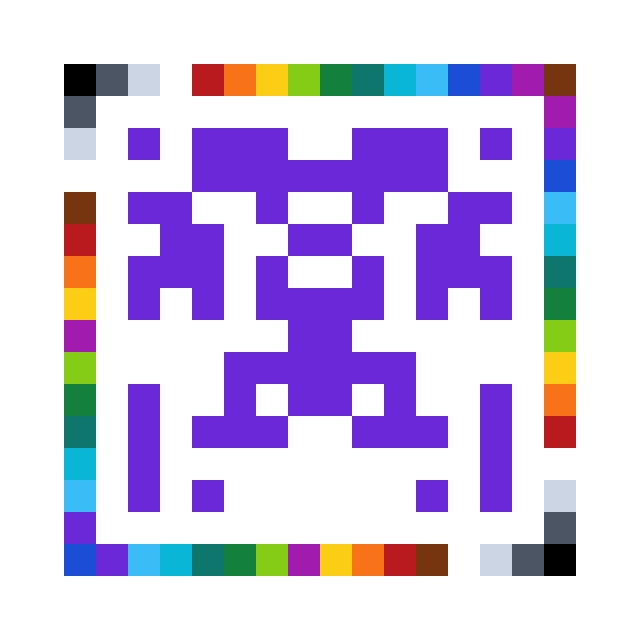

# Int32 Identicon

**把任意 Int32 编码成可扫描的对称图标。** GitHub Identicon 风格，Rust 核心，WebAssembly 本地识别，MIT 开源。

A reversible, screen-scannable Int32 symbol: a fixed 16-color reference frame around a monochrome, horizontally symmetric payload. Inspired by GitHub identicons; independent and not affiliated with GitHub.

[在线实验页](https://darrennong.github.io/int32-identicon/) · [V1 协议](docs/PROTOCOL-V1.md) · [需求与任务](docs/REQUIREMENTS.zh-CN.md) · [验证记录](docs/VALIDATION.md) · [路线](docs/ROADMAP.md)

<p align="center"></p>

> **实验版本 0.1.1，手机连续扫描尚未验收。** Rust 编解码、真实样例和静态图像识别已实现；浏览器具备 WASM、Worker、图片导入和摄像头三帧确认。0.1.1 改用多色边框定位，可在周围有屏幕文字和灰色界面的画面中寻找图标；一张用户提供的手机相机预览截图已从像素解出 `123456789`。完整色卡和白色留边仍需清晰；真实屏幕扫描成功率、误接受与延迟，仍需按[实机矩阵](docs/VALIDATION.md)测量。

## 图像与容量

| 区域 | 规格 | 作用 |
|---|---|---|
| 外层 | 16×16 最外圈，60 格 | 固定 16 色参考，不承载整数 |
| 白色圈 | 14×14 的边框，52 格 | 白色参考与空间分隔 |
| 内部 | 12×12，左右镜像 | 前景色 / 白色二分类 |
| 独立编码 | 左侧 6×12 | 72 bit，右侧仅镜像 |

完整 72 bit：`[版本:4 | 颜色:4 | Int32:32 | CRC-16:16 | RS校验:16]`。负数按补码；字节与位均高位优先；固定可逆掩码改善视觉分布。RS(9,7) 能纠正 1 个未知错误字节，或恢复最多 2 个已知擦除字节。CRC 负责校验，不提供身份认证。

## 使用

需要 [Rust](https://rustup.rs/)（仓库固定工具链）、Node.js 22.12+。不用后台或数据库。

```sh
git clone https://github.com/darrennong/int32-identicon.git
cd int32-identicon
cargo test --workspace --locked
cargo run -p int32-identicon-cli -- encode -2147483648 min.svg
cargo run -p int32-identicon-cli -- encode 123456789 example.png 12
cargo run -p int32-identicon-cli -- decode example.png
cargo run -p int32-identicon-cli -- examples examples
npm ci
npm run build
npm test
npm run dev
```

`build` 从 wasm-bindgen 官方 Release 下载固定版本工具并验证 SHA-256，随后编译 Rust/WASM 与 TypeScript。仅在执行 `dev` 时启动开发服务器。静态产物在 `web/dist/`；附 GitHub Pages 工作流。手机摄像头需要 HTTPS；手机访问普通 HTTP 局域网地址通常不可以。

在一块屏幕打开生成页，在另一台手机打开扫描页，让一个图标及白色留边进入取景框。浏览器不上传图像、不接入分析服务、不加载外部 CDN。静态图片结果注明单帧；摄像头要求 3 个不同、连续且及时的帧一致；不确定、校验失败或多个不同有效结果都不会输出整数。

## 目录与状态

| 目录 | 内容 |
|---|---|
| `crates/core/` | Rust 协议、RS、CRC、网格、SVG、定位与透视采样、WASM |
| `crates/cli/` | PNG/SVG 编码、PNG/JPEG 解码、真实样例生成与验证 |
| `web/` | TypeScript、摄像头、Worker、多帧确认 |
| `examples/` | 10 张真实 PNG + 10 张 SVG、整数与码字清单 |
| `tests/fixtures/` | 15 个固定向量（含 Int32 边界） |
| `scripts/` | 独立 JS 参考编码器、WASM 构建与像素测试 |
| `docs/` | 协议、需求、路线、验证记录 |

- [x] V1 数字协议、16 HEX、CRC、RS 与可逆掩码
- [x] Rust 核心、10 万随机往返、镜像与结构测试
- [x] 10 个真实随机样例，PNG 逐张从像素解码
- [x] 静态图片与透视采样原型，合成色偏 / 噪声测试
- [x] WASM、Worker、摄像头与多帧确认源码
- [ ] 复杂背景、反光、模糊和大倾角定位
- [ ] iPhone Safari / Android Chrome 真机验收与性能报告

不承诺尚未测量的帧率、最小尺寸、距离或误接受率。打印识别与离线缓存后续再做。贡献指南见 [CONTRIBUTING.md](CONTRIBUTING.md)。

## License

[MIT](LICENSE). This is a data encoding, not a cryptographic signature or a replacement for standardized QR codes.
